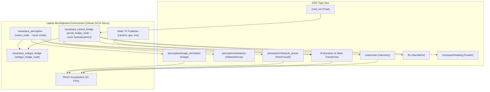

# Catatan Progres Migrasi Arsitektur ROS2 ASV Navantara

**Tanggal**: 13 November 2026  
**Waktu**: 02:15 WIB  
**Status**: Fase 1 (Selesai 100%) — Verifikasi Mock Laptop Berhasil  
**Branch Git**: [`ros2-migration`](https://github.com/nabilanaufal12/asv_control_system-new/tree/ros2-migration)  
**Lingkungan Uji**: Laptop Razer Blade 14 (Ubuntu 24.04.5 LTS x86_64, ROS 2 Jazzy Jalisco)

---

## 1. Ringkasan Eksekutif

Sistem kontrol monolitik ASV Navantara berbasis Python multithread dan Arduino lama telah berhasil ditransformasikan ke dalam fondasi arsitektur **modular ROS 2 (Humble/Jazzy cross-compatible)**.

Seluruh 7 paket ROS 2 di [`navantara_ros2_ws`](file:///home/mizuuu/Documents/Koleksi_KKI_Navantara_ASV/4_Firmware_dan_Source_Code/asv_control_system_jetson/navantara_ros2_ws) berhasil di-build tanpa error menggunakan `colcon`. Mode pengembangan laptop (*Laptop Mock Development Mode*) telah diuji langsung menggunakan visualisasi **RViz2**:
* ✅ Sensor visual kamera sintetis (`CameraView`) aktif mendeteksi bola merah & hijau pada ~31 FPS.
* ✅ Dinamika pergerakan kapal 2D (kecepatan *surge*, inersia, hambatan air, dan *yaw rate*) merespons topik `/cmd_vel` secara mulus.
* ✅ Lintasan odometri melingkar (`/odom/raw`) terproyeksi secara *real-time* di RViz2.
* ✅ *Hardware watchdog timer* (0.5s) aktif melindungi kapal saat perintah kemudi berhenti.
* ✅ Log telemetri misi tercatat otomatis dalam format CSV di folder `mission_logs/`.

---

## 2. Status Modul & Paket ROS 2

| Paket | Tipe Build | Status | Fitur Utama yang Telah Berjalan |
| :--- | :--- | :--- | :--- |
| **`navantara_interfaces`** | `ament_cmake` | ✅ Selesai | Custom messages: `Obstacle.msg`, `ObstacleArray.msg`, `ASVTelemetry.msg` |
| **`navantara_perception`** | `ament_python` | ✅ Selesai | • Inferensi GPU TensorRT (`best.engine`) untuk Jetson Orin • Fallback generator bola pelampung sintetis untuk pengujian laptop • Estimasi jarak hibrida (lebar pinhole + proyeksi raycast dasar bola pitch $5^\circ$) • Proyeksi 3D ke `sensor_msgs/PointCloud2` untuk Nav2 costmap |
| **`navantara_control_bridge`** | `ament_python` | ✅ Selesai | • Driver komunikasi serial UART ber-CRC16 dan legacy ASCII • Model hidrodinamika 2D kapal 50 Hz (`mock_hardware:=true`) • Dynamic TF `odom` $\rightarrow$ `base_link` • Failsafe hardware watchdog 0.5s auto-kill thrust • Firmware hardware-timer 100 Hz (`asv_mcu_bridge.ino`) |
| **`navantara_localization`** | `ament_python` | ✅ Selesai | Konfigurasi Extended Kalman Filter (`ekf.yaml`) dan integrasi RTK GPS via `robot_localization` |
| **`navantara_navigation`** | `ament_python` | ✅ Selesai | • Konfigurasi local costmap persistensi memori 4 detik (`nav2_params.yaml`) • Behavior tree navigasi rintangan (`asv_buoy_mission.xml`) • Master launch file [`navantara_bringup.launch.py`](file:///home/mizuuu/Documents/Koleksi_KKI_Navantara_ASV/4_Firmware_dan_Source_Code/asv_control_system_jetson/navantara_ros2_ws/src/navantara_navigation/launch/navantara_bringup.launch.py) • Preset visualisasi [`navantara_view.rviz`](file:///home/mizuuu/Documents/Koleksi_KKI_Navantara_ASV/4_Firmware_dan_Source_Code/asv_control_system_jetson/navantara_ros2_ws/src/navantara_navigation/config/navantara_view.rviz) |
| **`navantara_webgui_bridge`** | `ament_python` | ✅ Selesai | Pencatat log telemetri non-blocking ke CSV dan jembatan data ke Web GUI dashboard |
| **`navantara_gazebo_sim`** | `ament_cmake` | ✅ Selesai | Model 3D URDF katamaran ASV (`asv.urdf.xacro`) dan dunia air lintasan lomba (`kki_arena_course.world`) |

---

## 3. Masalah Teknis yang Telah Terselesaikan

1. **Error Eksekusi Libexec (`lib/navantara_perception does not exist`)**:
   * *Penyebab*: Paket Python ROS 2 (`ament_python`) membutuhkan file `setup.cfg` agar `setuptools` meletakkan script executable ke direktori libexec ROS 2 (`install/<pkg>/lib/<pkg>/`), bukan ke `bin/`.
   * *Solusi*: Ditambahkan `setup.cfg` standar pada seluruh paket Python.
2. **Konflik NumPy 2.x dengan OpenCV 4.6.0 & rosidl**:
   * *Penyebab*: Paket pip `numpy 2.5.4` lokal di `~/.local` mengganggu pustaka `python3-opencv` dan header C Python generator ROS 2 Jazzy.
   * *Solusi*: Dihapus instalasi pip lokal agar sistem kembali menggunakan `python3-numpy 1.26.4` bawaan resmi Ubuntu 24.04.
3. **Penyelarasan QoS Telemetri**:
   * Diselaraskan seluruh publisher sensor status dan subscriber telemetri ke `QoSProfile(reliability=RELIABLE)` untuk mencegah *QoS incompatible warning*.

---

## 4. Berkas Dokumentasi & Kode di Repositori

Semua perubahan telah di-push ke GitHub remote:
* **Branch**: `ros2-migration`
* **Daftar Berkas Utama**:
  * `docs/ROADMAP_ROS2_MIGRATION.md`: Dokumen audit komprehensif arsitektur lama vs baru.
  * `navantara_ros2_ws/src/`: Seluruh kode sumber 7 paket ROS 2.
  * `navantara_ros2_ws/src/navantara_navigation/launch/navantara_bringup.launch.py`: Master bringup runner.

---

## 5. Rencana Tahapan Berikutnya (Next Milestones)

1. **Visualisasi Fisik 3D Lambung Kapal di RViz2**:
   * Mengintegrasikan `robot_state_publisher` dan model 3D katamaran [`asv.urdf.xacro`](file:///home/mizuuu/Documents/Koleksi_KKI_Navantara_ASV/4_Firmware_dan_Source_Code/asv_control_system_jetson/navantara_ros2_ws/src/navantara_gazebo_sim/urdf/asv.urdf.xacro) ke RViz2 agar bodi kapal terlihat nyata saat berlayar.
2. **Navigator Otonom Pelampung KKI (`buoy_navigator_node.py`)**:
   * Membuat node otonom yang membaca `/perception/obstacles`, menghitung titik tengah lintasan bola merah dan hijau (*gate midpoint*), serta menerbitkan `/cmd_vel` secara otomatis tanpa input manual.
3. **Rolling Costmap 2D Nav2 di RViz2**:
   * Menampilkan lapisan grid rintangan spasial Nav2 di RViz2 dengan persistensi memori 4 detik.
4. **Validasi Hardware Lab (NVIDIA Jetson Orin + ESP32)**:
   * Menguji inferensi TensorRT FP16 nyata menggunakan kamera USB di Jetson dan menghubungkan kabel serial UART ke ESP32.
