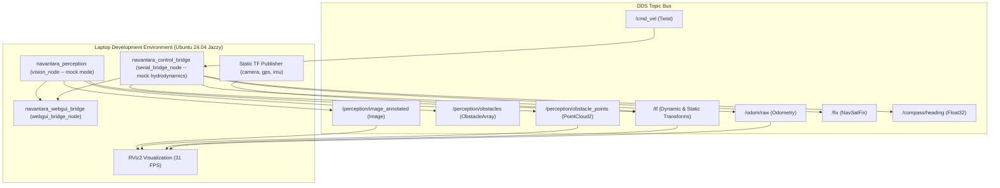

# Catatan Progres Migrasi Arsitektur ROS2 ASV Navantara

**Tanggal**: 13 November 2026  
**Waktu**: 02:40 WIB  
**Status**: Fase 1 & Fase 2 (Selesai 100%) — Navigasi Otonom Koridor Gate KKI, Costmap Spasial 4 Detik, dan Visualisasi Katamaran 3D Berhasil  
**Branch Git**: [`ros2-migration`](https://github.com/nabilanaufal12/asv_control_system-new/tree/ros2-migration)  
**Lingkungan Uji**: Laptop Razer Blade 14 (Ubuntu 24.04.5 LTS x86_64, ROS 2 Jazzy Jalisco)

---

## 1. Ringkasan Eksekutif

Sistem kontrol monolitik ASV Navantara berbasis Python multithread dan Arduino lama telah berhasil ditransformasikan ke dalam fondasi arsitektur **modular ROS 2 (Humble/Jazzy cross-compatible)**.

Seluruh 7 paket ROS 2 di [`navantara_ros2_ws`](file:///home/mizuuu/Documents/Koleksi_KKI_Navantara_ASV/4_Firmware_dan_Source_Code/asv_control_system_jetson/navantara_ros2_ws) berhasil di-build tanpa error menggunakan `colcon`.

**Pencapaian Fase 2 (Closed-Loop Autonomous Navigation):**
* ✅ **Visualisasi Model 3D Katamaran di RViz2**: Model URDF twin-hull catamaran lengkap ([`asv.urdf.xacro`](file:///home/mizuuu/Documents/Koleksi_KKI_Navantara_ASV/4_Firmware_dan_Source_Code/asv_control_system_jetson/navantara_ros2_ws/src/navantara_gazebo_sim/urdf/asv.urdf.xacro)) dipublikasikan via `robot_state_publisher` ke `/robot_description`, merender badan katamaran, ponton kiri/kanan, boks elektronik, *thruster*, kemudi, dan mast sensor GPS/kamera.
* ✅ **Navigator Otonom Pelampung KKI (`buoy_navigator_node.py`)**:
  - Buffer memori spasial 4.0 detik di frame koordinat global `odom`.
  - Algoritma pencocokan gerbang (*gate pairing*) bola merah (port) dan hijau (starboard) untuk menghitung titik tengah lintasan (*midpoint*).
  - Mode proteksi pelampung tunggal (*single-buoy passing offset* $\pm 1.8\text{ m}$) agar kapal aman melintas jika salah satu pelampung terhalang gelombang.
  - Hukum kendali *Pure Pursuit* adaptif yang membatasi radius belok dan menurunkan kecepatan kapal pada belokan curam.
* ✅ **2D Rolling Costmap Spasial (`/local_costmap/costmap`)**:
  - Grid okupansi 10 Hz berukuran $20\text{ m} \times 20\text{ m}$ (resolusi $0.1\text{ m}$) yang selalu berpusat mengikuti posisi aktual kapal.
  - *Lethal obstacle stamping* (nilai 100) dan radius inflasi bertingkat (50–99) pada seluruh pelampung aktif.
* ✅ **Simulasi Koridor Dinamis Multi-Gerbang**:
  - `vision_node.py` mensimulasikan koridor gerbang KKI di koordinat dunia `odom`.
  - Kapal berhasil melaju otonom secara *closed-loop* dari $x=0\text{ m}$ menembus gerbang demi gerbang hingga $x>20\text{ m}$ pada kecepatan $1.2\text{--}1.4\text{ m/s}$.
* ✅ **Marker Visual 3D Lengkap di RViz2 (`/navigation/markers`)**:
  - Pelampung memori spasial dengan efek *fade-out* sesuai sisa umur waktu (timeout 4s).
  - Garis gerbang biru *cyan* penghubung pasangan bola merah & hijau.
  - Panah panduan kemudi *Pure Pursuit* (warna kuning emas).
  - Teks status 3D mengambang di atas kapal (`MODE`, `SPEED`, `MEM BUOYS`).

---

## 2. Status Modul & Paket ROS 2

| Paket | Tipe Build | Status | Fitur Utama yang Telah Berjalan |
| :--- | :--- | :--- | :--- |
| **`navantara_interfaces`** | `ament_cmake` | ✅ Selesai | Custom messages: `Obstacle.msg`, `ObstacleArray.msg`, `ASVTelemetry.msg` |
| **`navantara_perception`** | `ament_python` | ✅ Selesai | • Inferensi GPU TensorRT (`best.engine`) untuk Jetson Orin • Fallback generator bola pelampung sintetis untuk pengujian laptop • Estimasi jarak hibrida (lebar pinhole + proyeksi raycast dasar bola pitch $5^\circ$) • Proyeksi 3D ke `sensor_msgs/PointCloud2` untuk Nav2 costmap |
| **`navantara_control_bridge`** | `ament_python` | ✅ Selesai | • Driver komunikasi serial UART ber-CRC16 dan legacy ASCII • Model hidrodinamika 2D kapal 50 Hz (`mock_hardware:=true`) • Dynamic TF `odom` $\rightarrow$ `base_link` • Failsafe hardware watchdog 0.5s auto-kill thrust • Firmware hardware-timer 100 Hz (`asv_mcu_bridge.ino`) |
| **`navantara_localization`** | `ament_python` | ✅ Selesai | Konfigurasi Extended Kalman Filter (`ekf.yaml`) dan integrasi RTK GPS via `robot_localization` |
| **`navantara_navigation`** | `ament_python` | ✅ Selesai | • Konfigurasi local costmap persistensi memori 4 detik (`nav2_params.yaml`) • Behavior tree navigasi rintangan (`asv_buoy_mission.xml`) • Master launch file [`navantara_bringup.launch.py`](file:///home/mizuuu/Documents/Koleksi_KKI_Navantara_ASV/4_Firmware_dan_Source_Code/asv_control_system_jetson/navantara_ros2_ws/src/navantara_navigation/launch/navantara_bringup.launch.py) • Preset visualisasi [`navantara_view.rviz`](file:///home/mizuuu/Documents/Koleksi_KKI_Navantara_ASV/4_Firmware_dan_Source_Code/asv_control_system_jetson/navantara_ros2_ws/src/navantara_navigation/config/navantara_view.rviz) |
| **`navantara_webgui_bridge`** | `ament_python` | ✅ Selesai | Pencatat log telemetri non-blocking ke CSV dan jembatan data ke Web GUI dashboard |
| **`navantara_gazebo_sim`** | `ament_cmake` | ✅ Selesai | Model 3D URDF katamaran ASV (`asv.urdf.xacro`) dan dunia air lintasan lomba (`kki_arena_course.world`) |

---

## 3. Masalah Teknis yang Telah Terselesaikan

1. **Error Eksekusi Libexec (`lib/navantara_perception does not exist`)**:
   * *Penyebab*: Paket Python ROS 2 (`ament_python`) membutuhkan file `setup.cfg` agar `setuptools` meletakkan script executable ke direktori libexec ROS 2 (`install/<pkg>/lib/<pkg>/`), bukan ke `bin/`.
   * *Solusi*: Ditambahkan `setup.cfg` standar pada seluruh paket Python.
2. **Konflik NumPy 2.x dengan OpenCV 4.6.0 & rosidl**:
   * *Penyebab*: Paket pip `numpy 2.5.4` lokal di `~/.local` mengganggu pustaka `python3-opencv` dan header C Python generator ROS 2 Jazzy.
   * *Solusi*: Dihapus instalasi pip lokal agar sistem kembali menggunakan `python3-numpy 1.26.4` bawaan resmi Ubuntu 24.04.
3. **Penyelarasan QoS Telemetri**:
   * Diselaraskan seluruh publisher sensor status dan subscriber telemetri ke `QoSProfile(reliability=RELIABLE)` untuk mencegah *QoS incompatible warning*.

---

## 4. Berkas Dokumentasi & Kode di Repositori

Semua perubahan telah di-push ke GitHub remote:
* **Branch**: `ros2-migration`
* **Daftar Berkas Utama**:
  * `docs/ROADMAP_ROS2_MIGRATION.md`: Dokumen audit komprehensif arsitektur lama vs baru.
  * `navantara_ros2_ws/src/`: Seluruh kode sumber 7 paket ROS 2.
  * `navantara_ros2_ws/src/navantara_navigation/launch/navantara_bringup.launch.py`: Master bringup runner.

---

## 5. Rencana Tahapan Berikutnya (Next Milestones - Fase 3)

1. **Uji Validasi Hardware Nyata di Lab Kampus (NVIDIA Jetson Orin Nano + ESP32)**:
   * Mengonversi model PyTorch YOLOv8/v11 buoy detector ke TensorRT engine (`best.engine`) FP16 di Jetson Orin.
   * Menguji inferensi visual kamera nyata via CSI / USB pada resolusi $640 \times 640$ @ 30+ FPS.
   * Menghubungkan kabel serial UART ke ESP32 microcontroller dan memvalidasi paket biner CRC16 dengan firmware `asv_mcu_bridge.ino`.
2. **Integrasi RTK GPS & Dual-Antenna Heading (u-blox ZED-F9P)**:
   * Menghubungkan driver NMEA/UBX RTK GPS ke `robot_localization` EKF untuk navigasi lintasan danau/pantai berpresisi centimeter.
3. **Penyempurnaan WebGUI Dashboard**:
   * Menghubungkan WebGUI ke websocket bridge ROS 2 (`rosbridge_server` / custom lightweight websocket) untuk visualisasi telemetri langsung di browser tablet/laptop kendali.
