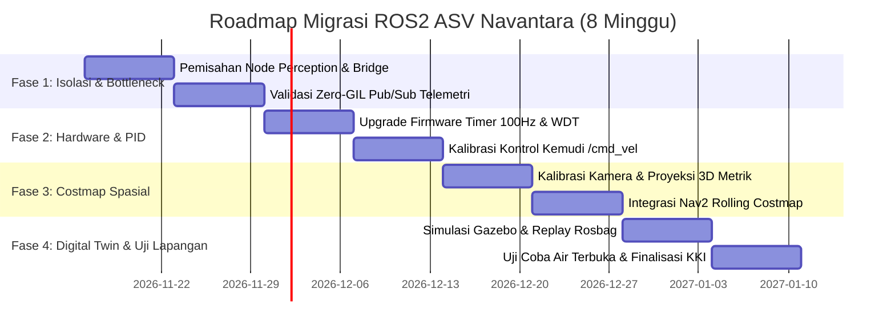

# Audit Arsitektur & Roadmap Migrasi ROS2 ASV Navantara

Dokumen ini menyajikan analisis komprehensif terhadap arsitektur monolitik sistem kontrol ASV Navantara (*Autonomous Surface Vessel*), menghubungkan visi teknologi modern dari referensi video robotika, dan memetakan rencana migrasi bertahap ke arsitektur modular berbasis **ROS2 (Humble/Iron)**, **Nav2**, **TensorRT**, dan **Gazebo**.

---

## 1. Analisis & Sintesis Video Tech Stack Robotika

Berdasarkan video referensi [`#coding #ai #programming #robotics.mp4`](file:///home/mizuuu/Downloads/%23coding%20%23ai%20%23programming%20%23robotics.mp4), terdapat *blueprint* hierarki komputasi robotika otonom standar industri. Berikut komparasi langsung antara konsep video, kondisi riil Navantara saat ini, dan target arsitektur ROS2:

```mermaid
graph TD
    subgraph VideoTechStack["Robotics Tech Stack (Video Referensi)"]
        V_Brain["Raspberry Pi / SBC → High-Level Brain"]
        V_MCU["STM32 → Real-time Control"]
        V_CV["OpenCV → Computer Vision"]
        V_YOLO["YOLO → Object Detection"]
        V_ROS2["ROS2 → Node Communication"]
        V_Nav2["Nav2 → Autonomous Navigation"]
        V_SLAM["SLAM / Costmap → Spatial Memory"]
        V_PID["PID → Closed-loop Feedback"]
        V_Gazebo["Gazebo → Physics Simulation"]
        V_Ollama["Ollama → Edge AI Reasoning"]
    end

    subgraph NavantaraROS2["Target Arsitektur ASV Navantara"]
        N_Jetson["NVIDIA Jetson Orin (ROS2 Humble Core)"]
        N_MCU["ESP32/STM32 (Micro-ROS / Hardware-timed Bridge)"]
        N_Perception["navantara_perception (TensorRT Engine + 3D Projection)"]
        N_DDS["CycloneDDS Zero-Copy Inter-Process Bus"]
        N_Nav2["navantara_navigation (Nav2 Rolling 2D Costmap)"]
        N_Control["navantara_control_bridge (Failsafe Watchdog & Actuators)"]
        N_Sim["navantara_gazebo_sim (Hydrodynamics & Buoy Course)"]
        N_Web["navantara_webgui_bridge (Async Telemetry & Monitoring)"]
    end

    V_Brain -.-> N_Jetson
    V_MCU -.-> N_MCU
    V_CV & V_YOLO -.-> N_Perception
    V_ROS2 -.-> N_DDS
    V_Nav2 & V_SLAM -.-> N_Nav2
    V_PID -.-> N_Control
    V_Gazebo -.-> N_Sim
```



| Komponen di Video | Peran di Robotika | Kondisi Monolitik Navantara Saat Ini | Target Implementasi ROS2 Navantara |
| :--- | :--- | :--- | :--- |
| **Raspberry Pi / SBC** | High-level Brain | Jetson Orin menjalankan skrip Python tunggal multi-thread dengan Flask & Eventlet | Jetson Orin menjalankan *isolated* ROS2 lifecycle nodes terdistribusi antar core CPU/GPU |
| **STM32 / MCU** | Real-time Control | ESP32 menjalankan sketch Arduino monolitik (parsing NMEA, kalkulasi waypoint, OLED, PID) | ESP32/STM32 murni mengeksekusi kontrol aktuator berpewaktu perangkat keras (100 Hz timer) & watchdog |
| **OpenCV + YOLO** | Vision & Deteksi | `vision_service.py` memproses deteksi YOLOv11 sekaligus merender overlay dan streaming MJPEG | `navantara_perception` memisahkan *pipeline* inferensi GPU TensorRT dan proyeksi spasial 3D |
| **ROS2** | Komunikasi Node | `threading.Lock()` + Python GIL + REST SocketIO yang rentan *race condition* | DDS Pub/Sub (`rclpy` & `rclcpp`) deterministik dengan *zero-copy shared memory* |
| **Nav2 + SLAM** | Navigasi & Memori | Logika reaktif sederhana (*if-else* belok kiri/kanan); hilang pandangan kamera = hilang target | Nav2 Behavior Tree + Rolling `costmap_2d` dengan persistensi objek (memori spasial bola saat kapal terhempas ombak) |
| **PID** | Feedback Control | Terpecah dua: sebagian di Python (`navigation.py`), sebagian di Arduino (`firmware.ino`) | PID *heading* deterministik terpusat pada controller firmware, menerima target kecepatan `/cmd_vel` |
| **Gazebo** | Simulasi Fisika | Belum ada simulasi; semua pengujian harus langsung di air terbuka | `navantara_gazebo_sim` untuk simulasi hidrodinamika, sensor virtual, dan pengujian algoritma lintasan KKI |
| **Ollama** | Local AI / Edge Agent | Belum terintegrasi | Potensi integrasi LLM/VLM lokal pada Jetson untuk *natural language telemetry diagnosis* dan strategi misi |

---

## 2. Audit Kode & Analisis Bottleneck Kritis

Pemeriksaan mendalam terhadap repositori [`asv_control_system_jetson`](file:///home/mizuuu/Documents/Koleksi_KKI_Navantara_ASV/4_Firmware_dan_Source_Code/asv_control_system_jetson) mengidentifikasi 5 *bottleneck* arsitektur utama:

### 2.1. Python GIL Lock & Monolithic Threading (`asv_handler.py`)
- **Masalah**: Pada [`asv_handler.py`](file:///home/mizuuu/Documents/Koleksi_KKI_Navantara_ASV/4_Firmware_dan_Source_Code/asv_control_system_jetson/src/navantara_backend/core/asv_handler.py), fungsi `main_logic_loop` (lebih dari 600 baris) mengeksekusi:
  1. Pemeriksaan koneksi serial & rekoneksi.
  2. Prediksi dan update EKF (`self.ekf.predict(dt)`).
  3. Percabangan logika penghindaran rintangan reaktif (*hardcoded*).
  4. Penulisan file log ke disk (`self.logger.log_telemetry()`, blocking I/O).
  5. Emisi SocketIO ke Web GUI (`self._update_and_emit_state()`).
- **Dampak Fatal**: Karena semua thread Python berjalan di bawah satu interpreter (Global Interpreter Lock / GIL), jika transmisi WebSocket ke GUI lambat atau penulisan log microSD tersendat, siklus komputasi kontrol kemudi mengalami *jitter* (fluktuasi latensi dari 20ms hingga melonjak ke >250ms).

### 2.2. Ketiadaan Memori Spasial Rintangan ("Wave Roll Buoy Loss")
- **Masalah**: Pada implementasi lama, jika kamera mendeteksi bola pelampung hijau/merah, Jetson mengirimkan perintah manual `A` (*Actuator override*). Namun saat kapal diterpa gelombang laut (pitch & roll), bola pelampung keluar dari *field of view* kamera selama 0.3–1.0 detik.
- **Dampak Fatal**: Variabel `vision_target_active` seketika bernilai `False`. Sistem langsung jatuh kembali ke mode `W` (Waypoint normal). Ketika kapal kembali tegak dan bola terlihat lagi, sistem melompat kembali ke mode `A`. Akibatnya kemudi rudder dan thruster berosilasi secara kasar (*hunting behavior*), bahkan kapal berpotensi menabrak pelampung.
- **Solusi ROS2**: Menggunakan layer `costmap_2d` dengan parameter `observation_persistence: 4.0s`. Bola yang terdeteksi akan tetap hidup di peta lokal kapal selama 4 detik meskipun kamera kehilangan visual sesaat akibat guncangan air.

### 2.3. Protokol Serial ASCII Tanpa Checksum & Watchdog (`serial_service.py`)
- **Masalah**: [`serial_service.py`](file:///home/mizuuu/Documents/Koleksi_KKI_Navantara_ASV/4_Firmware_dan_Source_Code/asv_control_system_jetson/src/navantara_backend/services/serial_service.py) dan [`firmware.ino`](file:///home/mizuuu/Documents/Koleksi_KKI_Navantara_ASV/4_Firmware_dan_Source_Code/asv_control_system_jetson/firmware-asv/firmware/firmware.ino) berkomunikasi menggunakan string ASCII mentah (`"W\n"`, `"A,90,1650,1000,...\n"`).
- **Dampak Fatal**: Komunikasi tanpa CRC/checksum rentan terhadap *noise* elektromagnetik dari motor brushless (ESC) dan pompa air. Satu bit korup menyebabkan kegagalan parsing. Selain itu, ketiadaan *hardware watchdog* berisiko membuat kapal terus melaju kencang tanpa kendali jika kabel serial terlepas atau Jetson hang.

### 2.4. Arsitektur Terbelah / "Split-Brain" Navigation
- **Masalah**: Logika navigasi terpecah di dua otak:
  - Mikrokontroler (ESP32) di [`firmware.ino`](file:///home/mizuuu/Documents/Koleksi_KKI_Navantara_ASV/4_Firmware_dan_Source_Code/asv_control_system_jetson/firmware-asv/firmware/firmware.ino) menghitung bearing waypoint, cross-track error (XTE), dan heading PID sendiri.
  - Jetson di [`asv_handler.py`](file:///home/mizuuu/Documents/Koleksi_KKI_Navantara_ASV/4_Firmware_dan_Source_Code/asv_control_system_jetson/src/navantara_backend/core/asv_handler.py) juga menghitung EKF dan menginterupsi perintah kemudi.
- **Dampak Fatal**: Terjadi ketidaksinkronan titik koordinat dan orientasi antara kompas mentah di ESP32 dan fusi EKF di Jetson.

### 2.5. Kopling Erat Modul Vision (`vision_service.py`)
- **Masalah**: [`vision_service.py`](file:///home/mizuuu/Documents/Koleksi_KKI_Navantara_ASV/4_Firmware_dan_Source_Code/asv_control_system_jetson/src/navantara_backend/services/vision_service.py) memuat modul kamera, inferensi YOLO, komputasi navigasi otonom (`handle_autonomous_navigation`), pembuat stream MJPEG, dan utilitas manipulasi HTML/CSS.
- **Dampak Fatal**: Kegagalan inferensi atau crash pada streaming video web GUI langsung melumpuhkan logika navigasi kapal.

---

## 3. Struktur Direktori Workspace ROS2 Target

Workspace baru telah dibangun secara modular pada direktori:
[`/home/mizuuu/Documents/Koleksi_KKI_Navantara_ASV/4_Firmware_dan_Source_Code/navantara_ros2_ws/src/`](file:///home/mizuuu/Documents/Koleksi_KKI_Navantara_ASV/4_Firmware_dan_Source_Code/navantara_ros2_ws/src)

```text
navantara_ros2_ws/
└── src/
    ├── navantara_interfaces/                      # Custom ROS2 Messages & Services
    │   ├── CMakeLists.txt
    │   ├── package.xml
    │   └── msg/
    │       ├── ASVTelemetry.msg                   # Telemetri lengkap status kapal
    │       ├── Obstacle.msg                       # Posisi spasial 3D, bearing, jarak & kelas
    │       └── ObstacleArray.msg                  # Array deteksi rintangan per frame
    │
    ├── navantara_perception/                      # TensorRT Vision & 3D Projection
    │   ├── package.xml
    │   ├── setup.py
    │   ├── config/
    │   │   └── camera_calibration.yaml
    │   ├── launch/
    │   │   └── perception.launch.py
    │   └── navantara_perception/
    │       ├── __init__.py
    │       └── vision_node.py                     # [DELIVERABLE] Node TensorRT + PointCloud2
    │
    ├── navantara_localization/                    # Robot Localization & Sensor Fusion
    │   ├── package.xml
    │   ├── setup.py
    │   ├── config/
    │   │   └── ekf.yaml                           # [DELIVERABLE] Konfigurasi robot_localization
    │   ├── launch/
    │   │   └── localization.launch.py
    │   └── navantara_localization/
    │       └── __init__.py
    │
    ├── navantara_navigation/                      # Nav2 Planner, Controller & Memory Costmap
    │   ├── package.xml
    │   ├── setup.py
    │   ├── behavior_trees/
    │   │   └── asv_buoy_mission.xml
    │   ├── config/
    │   │   └── nav2_params.yaml                   # [DELIVERABLE] Costmap dengan memory persistence
    │   └── launch/
    │       └── navigation.launch.py
    │
    ├── navantara_control_bridge/                  # Hardware Serial Bridge & Watchdog
    │   ├── package.xml
    │   ├── setup.py
    │   ├── config/
    │   │   └── serial_bridge.yaml
    │   ├── firmware/
    │   │   └── asv_mcu_bridge.ino                 # [DELIVERABLE] Firmware 100Hz hardware timer & watchdog
    │   ├── launch/
    │   │   └── bridge.launch.py
    │   └── navantara_control_bridge/
    │       ├── __init__.py
    │       └── serial_bridge_node.py              # [DELIVERABLE] Bridge /cmd_vel & Telemetri
    │
    ├── navantara_webgui_bridge/                   # Telemetry Server & Web GUI Decoupling
    │   ├── package.xml
    │   ├── setup.py
    │   ├── launch/
    │   │   └── webgui.launch.py
    │   └── navantara_webgui_bridge/
    │       ├── __init__.py
    │       └── webgui_bridge_node.py              # [DELIVERABLE] Async Web Telemetry & CSV Logger
    │
    └── navantara_gazebo_sim/                      # 3D Digital Twin & Aquatic Physics Sim
        ├── CMakeLists.txt
        ├── package.xml
        ├── launch/
        │   └── sim.launch.py
        ├── models/
        ├── worlds/
        │   └── kki_arena_course.world
        └── urdf/
            └── asv.urdf.xacro                     # [DELIVERABLE] Hull catamaran model & sensor plugins
```

---

## 4. Tabel Pemetaan Migrasi Modul

| Modul Lama (`navantara_backend`) | Paket & Node ROS2 Baru | Topik Masukan (Sub) | Topik Keluaran (Pub) | Peningkatan Performa |
| :--- | :--- | :--- | :--- | :--- |
| `vision_service.py` & `export_tensorrt.py` | `navantara_perception` (`vision_node.py`) | `/camera/image_raw` atau V4L2 device | `/perception/obstacles`<br>`/perception/obstacle_points` (`PointCloud2`)<br>`/perception/image_annotated` | Eksekusi TensorRT murni pada GPU Jetson Orin; proyeksi piksel 2D ke metrik (jarak & bearing) dalam frame `base_link`. |
| `kalman_filter.py` & `firmware_gps_rtk_gga_f9p.ino` | `navantara_localization` (`robot_localization`) | `/fix` (`NavSatFix`)<br>`/compass/heading`<br>`/odom/raw` | `/odometry/filtered`<br>`/tf` (`odom` → `base_link`) | Fusi standar industri EKF 30 Hz dengan penanganan redundansi sensor, kovariansi dinamis, dan koreksi RTK NTRIP. |
| `navigation.py` & logika penghindar di `asv_handler.py` | `navantara_navigation` (`nav2_costmap_2d` & `regulated_pure_pursuit`) | `/odometry/filtered`<br>`/perception/obstacle_points`<br>`/plan_waypoints` | `/cmd_vel` (`geometry_msgs/Twist`) | Jalur mulus bebas sentakan (*pure pursuit*); retensi rintangan selama 4 detik di rolling costmap saat kapal pitch/roll. |
| `serial_service.py` & `firmware.ino` | `navantara_control_bridge` (`serial_bridge_node.py` + `asv_mcu_bridge.ino`) | `/cmd_vel` | `/fix`<br>`/compass/heading`<br>`/asv/telemetry`<br>`/odom/raw` | Komunikasi deterministik ber-CRC16, pewaktu perangkat keras 100 Hz di mikrokontroler, serta failsafe watchdog 500 ms otomatis. |
| `endpoints.py`, `mission_logger.py`, & `run_gui.py` | `navantara_webgui_bridge` (`webgui_bridge_node.py`) | `/asv/telemetry`<br>`/fix`<br>`/perception/image_annotated` | REST API / WebSockets ke Next.js Dashboard | Pemisahan total thread GUI dan logging disk dari siklus kendali navigasi (menghilangkan Python GIL lag). |
| `config/config.json` | Parameter YAML ROS2 di masing-masing paket | - | ROS2 Parameter Server dinamis | Parameter tuning PID, kecepatan, dan ambang deteksi dapat diubah secara dinamis (*dynamic reconfigure*) saat kapal berjalan. |

---

## 5. Ringkasan Implementasi Boilerplate Kode Utama

### 5.1. Vision Node ([`vision_node.py`](file:///home/mizuuu/Documents/Koleksi_KKI_Navantara_ASV/4_Firmware_dan_Source_Code/navantara_ros2_ws/src/navantara_perception/navantara_perception/vision_node.py))
- Menggunakan model pinhole kamera untuk mengubah lebar piksel $w$ dan offset horizontal $x$ menjadi:
  $$\text{Jarak } (Z) = \frac{f_x \times \text{Diameter Objek Riil}}{w_{piksel}}, \quad \text{Bearing } (\theta) = \frac{x_{center} - W/2}{W/2} \times \frac{\text{HFOV}}{2}$$
- Mentransformasi rintangan ke koordinat metrik lokal kapal:
  $$x = Z \cos(\theta), \quad y = -Z \sin(\theta), \quad z = 0$$
- Mengemas setiap deteksi ke format `sensor_msgs/msg/PointCloud2` secara efisien dengan *binary packing* sehingga langsung diumpankan ke *costmap* Nav2.

### 5.2. Serial Bridge Node ([`serial_bridge_node.py`](file:///home/mizuuu/Documents/Koleksi_KKI_Navantara_ASV/4_Firmware_dan_Source_Code/navantara_ros2_ws/src/navantara_control_bridge/navantara_control_bridge/serial_bridge_node.py))
- Menerjemahkan `/cmd_vel` standar (`linear.x` m/s dan `angular.z` rad/s) menjadi PWM thruster utama dan sudut rudder servo.
- Memiliki *watchdog timer* independen: jika sinyal navigasi terputus >0.5 detik, node otomatis mengirim perintah *neutral stop* ke mikrokontroler.
- Mendukung dua mode: protokol biner ber-CRC16 terstruktur untuk firmware baru dan protokol ASCII *fallback* untuk kompatibilitas firmware saat ini.

### 5.3. Firmware Pewaktu Perangkat Keras ([`asv_mcu_bridge.ino`](file:///home/mizuuu/Documents/Koleksi_KKI_Navantara_ASV/4_Firmware_dan_Source_Code/navantara_ros2_ws/src/navantara_control_bridge/firmware/asv_mcu_bridge.ino))
- Menggunakan hardware interrupt timer ESP32 pada 100 Hz dan modul hardware watchdog timer (WDT).
- Memisahkan thread pembacaan serial non-blocking dari eksekusi PWM motor dan servo.

---

## 6. Peta Jalan Eksekusi 4 Fase (Minggu 1 – 8)



- **Fase 1 (Minggu 1–2): Isolasi Proses & Eliminasi Bottleneck**
  - Menguji `vision_node.py` dan `serial_bridge_node.py` di Jetson Orin secara berdampingan dengan skrip lama.
  - Memastikan *frame rate* inferensi mencapai stabil 25–30 FPS tanpa memengaruhi frekuensi serial 50 Hz.
- **Fase 2 (Minggu 3–4): Upgrade Firmware MCU & Kontrol Deterministik**
  - Menerapkan `asv_mcu_bridge.ino` pada mikrokontroler.
  - Menghilangkan beban komputasi waypoint dari MCU; MCU murni mengeksekusi kontrol motor loop tertutup dan membaca sensor mentah.
- **Fase 3 (Minggu 5–6): Memori Spasial Nav2 & Proyeksi Kamera**
  - Mengalibrasi matriks intrinsik kamera (focal length $f_x$, distorsi) menggunakan papan catur (*checkerboard*).
  - Menguji persistensi bola rintangan pada *local costmap* saat kapal digoyang di air.
- **Fase 4 (Minggu 7–8): Simulasi Digital Twin Gazebo & Uji Coba KKI**
  - Menjalankan model `asv.urdf.xacro` di simulator air Gazebo dengan kondisi angin dan arus virtual.
  - Merekam seluruh misi menggunakan `ros2 bag` untuk analisis telemetri pasca-pelayaran.
